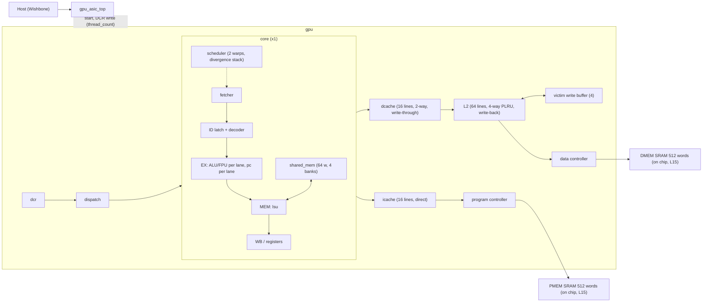

# 02 — Architecture of the ASIC profile

> Verified against commit `dadec7f` (+ uncommitted docs), 2026-10-21. Generic architecture (pipeline text, warp scheduler, PMU
> event list) is in the root [`README.md`](../../README.md); this page records what the **ASIC profile**
> actually instantiates.

## Profile parameters (`gpu_pkg.sv:27-45`, `-DTARGET_ASIC=1`)
<!-- BEGIN GENERATED: profile -->
| Parameter (`gpu_pkg.sv`) | ASIC | FPGA | sim (default) |
|---|---|---|---|
| `CFG_NUM_CORES` | 1 | 2 | 2 |
| `CFG_NUM_WARPS` | 2 | 4 | 4 |
| `CFG_THREADS_PER_BLOCK` | 4 | 4 | 4 |
| `CFG_PMEM_ADDR_BITS` | 12 | 16 | 32 |
| `CFG_PMEM_DATA_BITS` | 32 | 32 | 32 |
| `CFG_DMEM_ADDR_BITS` | 14 | 16 | 32 |
| `CFG_DMEM_DATA_BITS` | 32 | 32 | 32 |
| `CFG_SHARED_MEM_ADDR_BITS` | 8 | 8 | 8 |
| `CFG_SHARED_MEM_SIZE` | 64 | 256 | 256 |
| `CFG_DEBUG` | 0 | 1 | 1 |
| `CFG_L1_CACHE_LINES` | 16 | 16 | 16 |
| `CFG_L2_CACHE_LINES` | 64 | 256 | 256 |
| `CFG_L2_WAYS` | 4 | 4 | 4 |
| `CFG_L2_SECTORS` | 4 | 4 | 4 |
| `CFG_VWB_DEPTH` | 4 | 8 | 8 |
| `CFG_DATA_MEM_NUM_CHANNELS` | 1 | 4 | 4 |
| `CFG_PROGRAM_MEM_NUM_CHANNELS` | 1 | 1 | 1 |
<!-- END GENERATED: profile -->
Fixed for all profiles: `DATA_BITS=32`, `WORDS_PER_BLOCK=4`, `AXI_DATA_WIDTH=128` (a cache block = 4 words).
Derived: **8 threads per core** (`THREADS_PER_CORE = 4 × 2`). `MAX_MEM_ADDR` in `core.sv:13` is `0xFFFF`
regardless of the 14-bit data address width.

## Block diagram

Evidence: instantiations in `gpu.sv` (L2 `unified_cache`, `program_memory_controller`, `data_memory_controller`,
per-core `icache_inst`/`dcache_inst`) and `core.sv`.

## Pipeline (per core)
`IF` (fetcher + icache) → `ID` (combinational decoder, registered latch `id_*`) → `EX` (per-lane ALU, FPU, `pc`) →
`MEM` (LSU, shared memory) → `WB`. The FPU has a fixed 5-stage latency with a per-warp **RAW scoreboard**
(`core.sv`, `fp_pipe_*`, `fp_scoreboard`). Forwarding sources into EX: MEM-stage, WB-stage, LSU completion
(`core.sv:fwd_*`). Each lane has its **own** `pc` instance, so NZP flags and the return stack are per lane per warp.
- Fetch granularity: one instruction at a time, shared by both warps; the scheduler picks the warp
  combinationally each cycle (`scheduler.sv`, `found_var_comb` / `next_rr_var_comb`).
  **The fetched instruction must match the selected warp's PC** — enforced by `if_fetched_pc == if_pc`
  (`core.sv:107`) and the fetcher refetch (`fetcher.sv:74`); see [B3](05-bug-log.md#b3).
- Branch/call/divergence resolve in EX and flush the front end through the one-cycle pulse
  `flush_warp_mask` (`scheduler.sv`). The ID latch squash rule is subtle — see [B2](05-bug-log.md#b2).

## Control flow state (per warp)
| State | Where | Depth | Behaviour on overflow |
|---|---|---|---|
| Return (call) stack, per lane | `pc.sv:29` | 8, 3-bit pointer | wraps silently — [L6](04-limitations.md#l6) |
| Divergence stack, per warp | `scheduler.sv:57` | 4 | `stack_ptr` would exceed 4; SVA `sched_sva` flags it — [L7](04-limitations.md#l7) |
| NZP flags | `pc.sv` `nzp[warp]`, per lane | 3 bits | reset to 0 — [L5](04-limitations.md#l5) |

Divergence/reconvergence is described in [04-limitations L1](04-limitations.md#l1): groups are only merged when a
branch lands exactly on the stacked PC, or popped at `EXIT`.

## Memory hierarchy
| Level | Organisation | Write policy | Source |
|---|---|---|---|
| Shared memory | 64 words, 4 banks (bank = `addr[1:0]`), per-lane ports, bank-conflict serialisation, broadcast reads | n/a | `shared_mem.sv` |
| I-cache | 16 lines, direct mapped, 4-word blocks | read-only | `icache.sv` |
| D-cache (L1) | 16 lines = 8 sets × 2 ways | **write-through, no-allocate on write miss**, merges on write hit | `dcache.sv` |
| L2 (unified, data only) | 64 lines = 16 sets × 4 ways, PLRU, 4 sectors/block with dirty bits | **write-back**; evictions go through the victim write buffer | `l2_cache.sv`, `victim_write_buffer.sv` |
| External | 128-bit block interface, 1 program + 1 data channel via `controller.sv` | — | `gpu.sv` |
Note: the I-cache goes directly to the program controller; **it does not pass through the L2**.
Atomics (`ATOM_ADD/CAS`) are serialised lane-by-lane in the LSU (`lsu.sv` `ATOMIC_*` states): read block, add, write
back through the D-cache.

## Chip top: `gpu_asic_top` (`src/rtl/gpu_asic_top.sv`)
Pins: `clk`, `reset`, Wishbone slave (`wb_cyc_i, wb_stb_i, wb_we_i, wb_sel_i[3:0], wb_adr_i[31:0], wb_dat_i[31:0], wb_dat_o[31:0], wb_ack_o`), `gpu_done_pin`.
`wb_adr_i[31:12]` selects the page (`0x30000` = CSR, `0x30001` = memory window); every access is acked (registered ack, one transaction at a time).

| Address | R/W | Meaning |
|---|---|---|
| `0x3000_0000` | W | `[0]` start (level, held until written 0); `[1]` **soft reset** (8 cycles; clears DCR/scheduler/caches, keeps SRAM; other bits ignored); `[15:8]` → DCR 0x00 = `thread_count`. `start` reaches the GPU 2 cycles after the DCR write |
| `0x3000_0000` | R | `{16'b0, thread_count, 7'b0, start}` |
| `0x3000_0004` | R | `[0]` done, `[1]` busy, `[2]` gpu_oob (sticky), `[3]` host_blocked (sticky) |
| `0x3000_0004` | W | write 1 to `[2]`/`[3]` to clear |
| `0x3000_1000–17FF` | R/W | **PMEM**: 512 words = GPU instruction words 0..511 (byte strobes honoured) |
| `0x3000_1800–1FFF` | R/W | **DMEM**: 512 words = GPU data words 0..511 |
| other | R/W | acked; reads 0, writes ignored |

Memory (`gpu_mem_subsys.sv`, `mahi_sram.sv`): two 512×32 dual-port (1RW+1R) SRAMs, `mahi_sram` = the OpenRAM macro
`sky130_sram_2kbyte_1rw1r_32x512_8` when `MAHI_SRAM_MACRO` is defined (physical flow) or a behavioural array with the same
1-cycle read contract (simulation). The GPU side speaks the 128-bit block protocol: a block read is 4 sequential word reads on
port 1 (5 cycles), a block write is up to 4 word writes on port 0 (strobe per word, 4 cycles). The host owns the SRAM ports
whenever it issues a request, and is refused (`0xBAD0_BAD0`) while `busy`. Limits: [L15](04-limitations.md#l15),
[L16](04-limitations.md#l16). Host read latency: 3 cycles to ack; write: 2.

`device_control_address` is only ever 0 from this wrapper, so **PMU configuration DCR addresses (0x01, 0x02, 0x10–0x13)
are unreachable from the chip pins**; PMU snapshot outputs are left unconnected ([L13](04-limitations.md#l13)).

## Reset / run protocol
1. Assert `reset`; release.
2. Write `thread_count` (DCR 0x00) and `start=1`.
3. `dispatch.sv` (`dispatch.sv:30-103`): `total_blocks = ceil(thread_count / 8)`. Each core is reset, then handed one block
   (`core_block_id`, `core_thread_count` = 8, or the remainder for the last block); a finished core is reset again and
   gets the next block, so **with 1 core blocks run sequentially**. When `blocks_done == total_blocks` the dispatcher
   raises `flush_caches` (L1 D-cache + L2 write back dirty data); when every `cache_flush_done` is high it sets
   `done`. Results are only guaranteed to be in external memory **after `done`** (L2 is write-back).
4. `done` is cleared when `start` is low and the dispatcher is idle (`dispatch.sv` final `else done <= 0`).
   By code reading only (not simulated): while `start` stays high after completion, the
   `blocks_done == total_blocks && !flushing` condition re-triggers a flush repeatedly; `gpu_asic_top` keeps `start`
   set until the host writes 0, so the host should drop `start` after seeing `done`.
In simulation `src/tb/random/tb_random.sv` pulses `start` for 5 cycles (enough because `is_running` latches it) and drives the `gpu`
module directly through the same DCR sequence with a behavioural memory.
