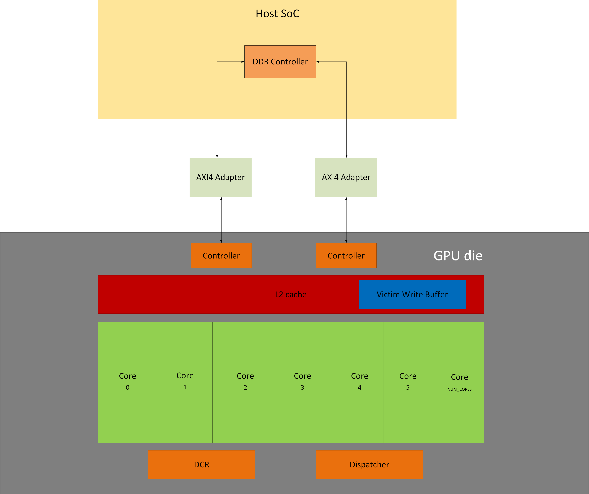
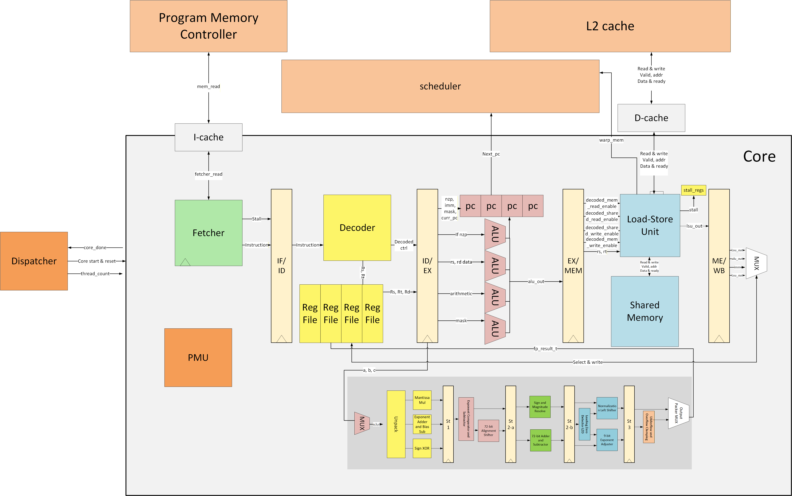

# mahi-gpu

> A full-stack GPGPU implementation in SystemVerilog — custom ISA, multi-warp SIMT scheduler, IEEE-754 FPU, multi-level cache hierarchy, AXI4 integration, and hardware performance monitoring — built from scratch as a learning platform for modern GPU microarchitecture.

<p align="center">
  
</p>

---

## Why this project exists

If you want to understand how a CPU works at the hardware level, the resources are everywhere — textbooks, open-source cores, university courses. GPUs are a different story.

The GPU market is extraordinarily competitive, and every major vendor (NVIDIA, AMD, Intel) keeps the microarchitectural details of their hardware tightly proprietary. You can learn CUDA. You can read the ISA manual. But the *how* — the scheduler, the divergence stack, the memory coalescing engine, the writeback buffer — is almost entirely undocumented.

**mahi-gpu** is an attempt to close that gap. It is a complete, synthesizable GPGPU built from first principles, where every design decision is visible and documented. The goal is not to compete with production hardware. The goal is to make the internals of a modern GPU legible.

This is especially relevant now. The architectures underlying ML accelerators (Google's TPU, Cerebras, Graphcore) share most of their DNA with GPGPUs: SIMD execution, high-bandwidth memory hierarchies, fused multiply-accumulate datapaths. Understanding mahi-gpu gives you the mental model for all of them.

> Special thanks to [tiny-gpu](https://github.com/adam-maj/tiny-gpu) by Adam Majmudar, which provided the initial architectural reference and motivation for this project.

---

## Table of Contents

- [Feature Highlights](#feature-highlights)
- [Architecture Overview](#architecture-overview)
  - [System Topology](#system-topology)
  - [Device Control Register (DCR)](#device-control-register-dcr)
  - [Dispatcher](#dispatcher)
  - [Memory Hierarchy](#memory-hierarchy)
  - [AXI4 Integration](#axi4-integration)
- [Compute Core](#compute-core)
  - [Execution Pipeline](#execution-pipeline)
  - [SIMT Warp Scheduler](#simt-warp-scheduler)
  - [Divergence & Reconvergence](#divergence--reconvergence)
  - [Forwarding & Hazard Handling](#forwarding--hazard-handling)
  - [Functional Units](#functional-units)
  - [Load-Store Unit (LSU)](#load-store-unit-lsu)
  - [Performance Monitoring Unit (PMU)](#performance-monitoring-unit-pmu)
- [Instruction Set Architecture](#instruction-set-architecture)
  - [Instruction Encoding](#instruction-encoding)
  - [Special Registers](#special-registers)
  - [Full Instruction Table](#full-instruction-table)
- [Programming Model](#programming-model)
  - [Kernel Launch Sequence](#kernel-launch-sequence)
  - [Thread Indexing](#thread-indexing)
  - [Memory Spaces](#memory-spaces)
- [Example Kernels](#example-kernels)
  - [Matrix Multiplication (5×5)](#matrix-multiplication-5x5)
  - [Parallel Tree Reduction](#parallel-tree-reduction)
- [Simulation & Tooling](#simulation--tooling)
  - [Running a Simulation](#running-a-simulation)
  - [Python Assembler](#python-assembler)
  - [Simulation Telemetry](#simulation-telemetry)
  - [DDR Latency Modeling](#ddr-latency-modeling)
- [Project Structure](#project-structure)
- [Design Decisions & Trade-offs](#design-decisions--trade-offs)
- [Advanced Functionality](#advanced-functionality)
- [References](#references)

---

## Feature Highlights

| Category | What's implemented |
|---|---|
| **Execution model** | Multi-warp SIMT, round-robin scheduling, hardware divergence stack |
| **Pipeline** | 5-stage (IF/ID/EX/MEM/WB), full forwarding network, FP RAW scoreboard |
| **Integer ALU** | ADD, SUB, MUL, DIV, MOD, AND, OR, XOR, SHL, SHR, MIN, MAX, ABS, NEG, MAC, POPCNT, CLZ, BREV |
| **Floating point** | Pipelined IEEE-754 FMA unit — FADD, FSUB, FMUL, FMA (5 pipeline stages) |
| **Memory** | L1 I-Cache + L1 D-Cache (per core), unified L2 (4-way PLRU), Victim Write Buffer |
| **Bus interface** | Full AXI4 Master on both instruction and data ports via `gpu_axi_wrapper` |
| **DDR simulation** | Behavioral tRCD/tCAS/tRP modeling in `axi_ram.sv` |
| **Shared memory** | Per-block banked SRAM with bank-conflict detection and read broadcast |
| **Atomics** | Serialized ATOM_ADD and ATOM_CAS with correct read-modify-write semantics |
| **Exceptions** | Divide-by-zero and out-of-bounds memory faults with warp isolation |
| **Subroutines** | CALL/RET_FN with per-warp hardware call stack (depth 8) |
| **PMU** | 32-event hardware bus, 4 configurable counters, snapshot registers |
| **Assembler** | Python assembler producing AXI-aligned 128-bit `.hex` arrays |

---

## Architecture Overview

### System Topology

The GPU is organized as a hierarchy: a single `gpu` top-level module contains the dispatch infrastructure, cache hierarchy, memory controllers, and a parameterizable number of compute cores. Each core is fully self-contained with its own instruction cache, data cache, shared memory, scheduler, and per-thread execution units.

```
┌─────────────────────────────────────────────────────────────┐
│  gpu_axi_wrapper                                            │
│  ┌──────────────────────────────────────────────────────┐   │
│  │  gpu                                                 │   │
│  │  ┌──────────┐  ┌──────────┐  ┌────────────────────┐  │   │
│  │  │   DCR    │  │Dispatcher│  │  Program Mem Ctrl  │  │   │
│  │  └──────────┘  └──────────┘  └────────────────────┘  │   │
│  │                                                      │   │
│  │  ┌─────────────────┐  ┌─────────────────┐            │   │
│  │  │  Core 0         │  │  Core N         │  ...       │   │
│  │  │  ┌──────────┐   │  │  ┌──────────┐   │            │   │
│  │  │  │ I-Cache  │   │  │  │ I-Cache  │   │            │   │
│  │  │  │ D-Cache  │   │  │  │ D-Cache  │   │            │   │
│  │  │  │ Shared   │   │  │  │ Shared   │   │            │   │
│  │  │  │ Mem      │   │  │  │ Mem      │   │            │   │
│  │  │  └──────────┘   │  │  └──────────┘   │            │   │
│  │  └─────────────────┘  └─────────────────┘            │   │
│  │                                                      │   │
│  │  ┌────────────────────────────────────────────────┐  │   │
│  │  │  Unified L2 Cache (4-way PLRU + VWB)           │  │   │
│  │  └────────────────────────────────────────────────┘  │   │
│  │  ┌──────────────────┐                                │   │
│  │  │  Data Mem Ctrl   │                                │   │
│  │  └──────────────────┘                                │   │
│  └──────────────────────────────────────────────────────┘   │
│  ┌──────────────┐  ┌──────────────┐                         │
│  │ AXI4 Adapter │  │ AXI4 Adapter │ (pmem / dmem)           │
│  └──────────────┘  └──────────────┘                         │
└─────────────────────────────────────────────────────────────┘
```

### Device Control Register (DCR)

The **DCR** (`dcr.sv`) is the CPU-facing control interface. It exposes a simple 8-bit address / 8-bit data write bus, through which the host can:

| Address | Function |
|---|---|
| `0x00` | Set `thread_count` — total threads to launch |
| `0x01` | Pulse `pmu_reset` — zero all PMU counters |
| `0x02` | Pulse `pmu_snapshot` — latch counters into shadow registers |
| `0x10–0x13` | Configure PMU counter 0–3 event selectors (5-bit mux) |

All writes are single-cycle. Pulse signals (`pmu_reset`, `pmu_snapshot`) are auto-cleared after one cycle.

### Dispatcher

The **Dispatcher** (`dispatch.sv`) transforms a flat thread count into a sequence of block assignments across cores.

- Computes `total_blocks = ceil(thread_count / (THREADS_PER_BLOCK × NUM_WARPS))`
- Assigns blocks to idle cores round-robin. As each core signals `done`, the dispatcher resets it and immediately assigns the next pending block
- Handles the last-block edge case where the thread count does not evenly divide into blocks — the last core receives a partial count
- Once all blocks complete, triggers a global cache flush and waits for all L1/L2 dirty lines to drain before asserting the top-level `done` signal

### Memory Hierarchy

The memory system is one of the most architecturally complete parts of mahi-gpu. Rather than a simple BRAM stub, it models a realistic multi-level hierarchy:

```
Thread                     Per-Core                    Shared            Global
  │                            │                          │                 │
  ├─ LDR/STR ──────────────────┤                          │                 │
  │                     ┌──────┴──────┐                   │                 │
  │                     │  L1 D-Cache │                   │                 │
  │                     │  (2-way,    │                   │                 │
  │                     │   16 lines) │                   │                 │
  │                     └──────┬──────┘                   │                 │
  │                            │ miss                     │                 │
  │                     ┌──────┴──────────────────────────┤                 │
  │                     │      Unified L2 Cache           │                 │
  │                     │      (4-way PLRU, 256 lines,    │                 │
  │                     │       Victim Write Buffer)      │                 │
  │                     └─────────────────────────────────┘                 │
  │                                     │ miss                              │
  │                              Data Memory Controller ─────────────────── │
  │                                                                         │
  ├─ LDSH/STSH ─────────────────────────────────────────────────────────────┤
                                   Shared Memory (per core, 256 words,
                                    4 banks, conflict detection)
```

**L1 Instruction Cache** (`icache.sv`): Direct-mapped, 16 lines × 128-bit blocks (4 instructions per block). On a miss, fetches the full 128-bit block and caches it. Block address is the instruction PC shifted right by 2. On a fill, validates that the requesting address still matches before asserting `core_read_ready` — this prevents stale delivery if the PC was flushed mid-flight.

**L1 Data Cache** (`dcache.sv`): 2-way set-associative, 16 lines (8 sets × 2 ways), write-through with LRU replacement. Manages 128-bit cache blocks. Write operations are passed through to L2 unconditionally; reads check the tag array on the same cycle they arrive. A latch captures `index`, `tag`, and `victim_way` on a miss to guard against address corruption during long L2 fills.

**Unified L2 Cache** (`l2_cache.sv`): 4-way set-associative, 256-line capacity, PLRU replacement with 3-bit pseudo-LRU tree per set. Supports `NUM_PORTS` upstream ports (one per core D-cache), served round-robin. Sector-granular dirty tracking (4 sectors per line, matching the 4-word cache block). Supports flush: a `FLUSH_SCAN` state iterates every set/way and pushes dirty lines into the VWB before transitioning to `FLUSH_WAIT` until the VWB drains completely.

**Victim Write Buffer** (`victim_write_buffer.sv`): A FIFO of depth 8 sitting behind L2. When the L2 evicts a dirty line, it pushes the address + data into the VWB rather than stalling for a main memory write. The VWB drains lazily to main memory using three triggers: half-full threshold, flush signal, or an idle-starvation counter (32 cycles). It also acts as a probe target — if the L2 is looking for an address that was recently evicted, the VWB can service the request directly, preventing a round-trip to DRAM. Supports sector-level merge for writes to the same address.

**Shared Memory** (`shared_mem.sv`): 256-word SRAM divided into 4 banks. All threads in a block can access shared memory simultaneously via `LDSH`/`STSH`. The hardware detects bank conflicts (two threads accessing the same bank at different addresses) and serializes them over multiple cycles. Read-broadcast (multiple threads reading the same address) is handled as a single read with result fanout.

### AXI4 Integration

The `gpu_axi_wrapper.sv` module wraps the GPU core and maps both its program memory and data memory ports to full AXI4-Master interfaces.

The `axi4_adapter.sv` handles the impedance mismatch between the GPU's simple valid/ready handshake and the AXI4 channel protocol:

- **Read path**: AR_WAIT → R_READ_WAIT. Asserts `arvalid`, waits for `arready`, then waits for `rvalid`. Translates the GPU's block address to an AXI byte address by left-shifting by `log2(BYTES_PER_BEAT)`.
- **Write path**: Issues `awvalid` and `wvalid` simultaneously. Transitions to RESP_WAIT only after both `awready` and `wready` have been seen. Expands the GPU's 4-bit word strobe to a 16-bit AXI byte strobe.

Burst length is locked to 1 beat (`awlen = arlen = 0`) matching the GPU's 128-bit block granularity.

---

## Compute Core

<p align="center">
  
</p>

### Execution Pipeline

Each core implements a 5-stage in-order pipeline. All THREADS_PER_BLOCK threads execute the same instruction in lockstep (SIMT), each with their own register values, ALU, and FPU instance.

```
  IF          ID            EX           MEM           WB
  ──          ──            ──           ───           ──
Fetcher   Decoder +     ALU / FPU     LSU async     Register
requests  register      per-thread    memory ops    writeback
instr     read +        execution     coalescing    + LSU/FPU
from      forwarding    Flags, NZP,   atomic        writeback
I-Cache   paths         divergence    serializer    priority
                        detection                   logic
```

**IF**: The Fetcher (`fetcher.sv`) maintains a 3-state FSM (IDLE → FETCHING → DONE). It issues a read to the I-Cache when the scheduler signals a valid warp. It holds the instruction in `DONE` until the pipeline consumes it (`consume` signal). On a flush, it immediately returns to IDLE discarding any in-flight fetch.

**ID**: The Decoder (`decoder.sv`) is purely combinational. It drives all downstream control signals: ALU op, register addresses, memory enables, FP flag, immediate extraction, PC mux control. No latency. The ID/EX register is clocked.

**EX**: Per-thread ALU and FPU instances execute in parallel. The NZP update, branch target evaluation, divergence detection, and exception detection all happen here. Results are forwarded directly to the next instruction's EX stage via the forwarding network.

**MEM**: Passes non-memory instructions straight through to WB. Memory instructions engage the LSU, which handles coalescing, shared memory dispatch, and atomic serialization asynchronously. The pipeline stalls at MEM for the duration of the memory operation.

**WB**: Three writeback sources are arbitrated with fixed priority: (1) FPU writeback (highest — comes from a fixed 5-cycle latency pipe), (2) LSU writeback, (3) integer ALU writeback. Each lower-priority path is guarded against collisions.

### SIMT Warp Scheduler

The scheduler (`scheduler.sv`) is the heart of the core. It maintains a state machine per warp with the following states:

| State | Meaning |
|---|---|
| `IDLE` | Warp not yet initialized |
| `READY` | Warp eligible for issue |
| `WAITING_MEM` | Warp stalled on an in-flight memory operation |
| `WAITING_FP` | Warp stalled on an in-flight FPU pipeline |
| `WAITING_BARRIER` | Warp at a `SYNC` instruction, waiting for all peers |
| `DONE_STATE` | Warp has completed all threads (EXIT reached with empty stack) |
| `FAULTED` | Warp trapped by an exception |

Each cycle, the scheduler scans the `READY` warp list round-robin (`rr_ptr`) and selects the first warp with a non-zero active mask and no pending flush. This selection is **combinational** — `if_pc`, `sched_active_mask`, and `sched_warp_id` are pure outputs of the comb logic, so the fetcher sees the target PC on the same cycle without a pipeline stall.

When a memory instruction enters the MEM stage, the scheduler:
1. Transitions the warp to `WAITING_MEM`
2. Asserts `flush_warp_mask` for that warp, discarding any partially-decoded instruction
3. Saves the correct resume PC (`mem_pc + 1`)

The warp is returned to `READY` when `warp_mem_ready` pulses from the memory pending counter in `core.sv`.

The FPU follows an identical pattern: `fp_req_valid` → `WAITING_FP`, `flush_warp_mask`, save PC. `fp_wb_valid` → return to `READY`.

### Divergence & Reconvergence

SIMT divergence occurs when threads in the same warp evaluate a branch differently. mahi-gpu handles this with a per-warp **hardware divergence stack** (depth 4):

1. **Detection**: In the EX stage, `ex_next_pc[t]` is computed for each active thread. If any two active threads produce different next PCs, `ex_has_divergence` is set.

2. **Split**: The scheduler classifies threads into two groups:
   - `mask_a` — threads going to `target_a` (the majority path)
   - `mask_b` — threads going to `target_b` (the divergent path)
   
   It pushes `{target_b, mask_b}` onto the divergence stack and continues executing with `{target_a, mask_a}`.

3. **Reconvergence**: After every non-divergent branch, the scheduler checks whether `target_a` matches the address at the top of the divergence stack. If it does, it pops the stack and merges the masks (`mask_a | stack_mask`), re-enabling the previously masked threads at the reconvergence point.

4. **EXIT handling**: If a warp reaches `EXIT` with a non-empty stack, it pops the next entry and continues with that mask. This correctly handles kernels where different threads exit the main body at different times but all need to reach the final divergence point.

### Forwarding & Hazard Handling

The forwarding network resolves RAW hazards for integer instructions without stalls. Three forwarding sources are checked per operand, per thread:

```
Priority 1: MEM stage  (most recent completed instruction)
Priority 2: WB  stage
Priority 3: LSU writeback (from asynchronous memory completion)
```

Forwarding is gated by warp ID match — a forwarded value from warp 0's MEM stage is not used by warp 1's EX stage, even if the register numbers match.

For the **FPU**, forwarding is not possible because the latency is 5 cycles and the FPU result does not pass through MEM/WB. Instead, a per-warp **scoreboard** (`fp_scoreboard[NUM_WARPS][32]`) tracks which registers have outstanding FPU results. When a new instruction in the ID stage needs a register that is set in the scoreboard, the scheduler inserts a **frontend stall** (`fp_raw_stall`) — freezing the IF/ID register until the FPU writes back and clears the bit.

### Functional Units

**Integer ALU** (`alu.sv`): Purely combinational, 18 operations, fully parameterized to `DATA_BITS`. Generates carry (`flag_c`), overflow (`flag_v`), zero (`flag_z`), negative (`flag_n`), and saturation (`flag_sat`) flags. Flags are written to per-thread, per-warp flag registers on instructions with `decoded_flags_write_enable`.

Notably, the ALU includes:
- `MAC` — multiply-accumulate in a single instruction (rd = rd + rs×rt), with overflow detection
- `POPCNT` — population count via loop unrolled at synthesis time
- `CLZ` — count leading zeros via a priority scan from MSB to LSB
- `BREV` — bit reversal

**FPU** (`fp32_fma.sv`): A 5-stage IEEE-754 single-precision Fused Multiply-Add pipeline. All four FP operations (FADD, FSUB, FMUL, FMA) are implemented by steering operands into the FMA datapath:

| Instruction | `eff_b` | `eff_c` | Computes |
|---|---|---|---|
| `FMA` | `b_in` | `c_in` | a×b + c |
| `FADD` | 1.0 | `b_in` | a×1 + b = a+b |
| `FMUL` | `b_in` | 0.0 | a×b + 0 = a×b |
| `FSUB` | 1.0 | `−b_in` | a×1 + (−b) = a−b |

Pipeline stages:
1. Mantissa multiply (48-bit product)
2a. Exponent alignment (72-bit operands aligned to common exponent)
2b. Addition or subtraction of aligned operands
3. Normalization (leading-one scan + left shift)
4. Pack result (handle overflow/underflow, assemble sign/exponent/mantissa)

### Load-Store Unit (LSU)

The **LSU** (`lsu.sv`) handles all memory traffic for a warp. It maintains per-warp request queues and services them one at a time.

**Coalescing**: For global memory reads and writes, the LSU uses a two-state loop (COALESCE → WAIT). On each iteration it finds the first pending thread, issues a single block-aligned memory request, and completes all threads whose address falls within that same cache block — potentially servicing multiple threads with one memory transaction. It then loops back to service any remaining threads with different block addresses.

**Shared memory**: All active threads issue their `LDSH`/`STSH` requests simultaneously. The shared memory module handles bank conflicts internally, asserting `read_ready`/`write_ready` per-thread when complete.

**Atomics**: `ATOM_ADD` and `ATOM_CAS` are serialized one thread at a time through ATOMIC_READ → ATOMIC_WAIT_READ → ATOMIC_WAIT_WRITE. Each thread reads the current memory value, computes the new value (add or conditional swap), and writes it back before the next thread proceeds. The old value is captured into the result register, matching CUDA's atomic return semantics.

### Performance Monitoring Unit (PMU)

The PMU (`core_pmu.sv`) exposes 32 hardware events via a single `event_bus[31:0]` wire in `core.sv`. Events include:

| Bits | Events |
|---|---|
| [3] | Cycle active |
| [4] | EX stage active |
| [5] | Instruction issued |
| [6] | Fetch stall |
| [7] | Pipeline flush |
| [8] | Memory operation |
| [9–11] | I-Cache access / hit / stall |
| [12–17] | Scheduler events: idle, warp switch, diverge, stall-mem, stall-barrier, stall-noready |
| [18–23] | D-Cache read/write access, hit, stall |
| [24–27] | FP fire, FP writeback, FP RAW stall, FP WB collision |

Each counter is independently multiplexed to any of the 32 events via the `cfg_mux_sel_N` inputs (configured through the DCR at addresses `0x10–0x13`). A `pmu_snapshot` pulse atomically latches all four counters into shadow registers, enabling race-free reads from the host even while the counters keep running.

---

## Instruction Set Architecture

All instructions are 32 bits wide. The opcode occupies bits [31:26] (6 bits, supporting up to 64 opcodes).

### Instruction Encoding

```
R-type (arithmetic, logic, memory):
31      26 25    21 20    16 15    11 10             0
┌──────────┬────────┬────────┬────────┬─────────────┐
│  OPCODE  │   RD   │   RS   │   RT   │   (unused)  │
└──────────┴────────┴────────┴────────┴─────────────┘

I-type (branches, immediate loads, memory with offset):
31      26 25    21 20    16 15                      0
┌──────────┬────────┬────────┬────────────────────────┐
│  OPCODE  │ RD/NZP │   RS   │    IMMEDIATE [15:0]    │
└──────────┴────────┴────────┴────────────────────────┘
```

The immediate is sign-extended to `DATA_BITS` (32 bits) in hardware. For `LUI`, the immediate is placed in the upper 20 bits (bits [31:12]) to enable full 32-bit constant loading in two instructions:

```asm
LUI  R0, 0x12345   ; R0 = 0x12345000
CONST R1, 0x678    ; R1 = 0x00000678
OR   R0, R0, R1    ; R0 = 0x12345678
```

For `BRnzp`, bits [25:23] of the instruction encode the NZP condition mask. The branch is taken if `(nzp_register & condition_mask) != 0`.

| Condition field | Meaning |
|---|---|
| `100` | Branch if Negative (N) |
| `010` | Branch if Zero (Z) |
| `001` | Branch if Positive (P) |
| `110` | Branch if Negative or Zero (N or Z, i.e. ≤ 0) |
| `101` | Branch if Negative or Positive (i.e. ≠ 0) |
| `011` | Branch if Zero or Positive (≥ 0) |
| `111` | Unconditional branch (BRnzp) |

### Special Registers

Each thread has 32 registers. The top three are read-only hardware registers initialized automatically at dispatch:

| Register | Alias | Value | Purpose |
|---|---|---|---|
| R29 | `%blockIdx` | Block ID assigned by dispatcher | Which block this thread belongs to |
| R30 | `%blockDim` | `THREADS_PER_BLOCK × NUM_WARPS` | Total threads per block |
| R31 | `%threadIdx` | `warp_id × THREADS_PER_BLOCK + thread_id` | Unique thread index within block |

The global thread ID (analogous to CUDA's `blockIdx.x * blockDim.x + threadIdx.x`) is computed in software:

```asm
MUL  R0, R29, R30   ; R0 = blockIdx * blockDim
ADD  R0, R0, R31    ; R0 = global thread ID
```

### Full Instruction Table

| Mnemonic | Opcode | Type | Operation | Notes |
|:---:|:---:|:---:|---|---|
| `NOP` | 0 | — | No operation | |
| `BRnzp` | 1 | I | PC ← imm if (NZP & cond) ≠ 0 | Condition in bits [25:23] |
| `CMP` | 2 | R | Set NZP from rs vs rt | Writes NZP register, not rd |
| `ADD` | 3 | R | rd = rs + rt | Sets flags |
| `SUB` | 4 | R | rd = rs − rt | Sets flags |
| `MUL` | 5 | R | rd = rs × rt (low 32 bits) | Sets overflow flag |
| `DIV` | 6 | R | rd = rs / rt | Raises DIV0 exception if rt = 0 |
| `LDR` | 7 | I | rd = MEM[rs + offset] | 16-bit sign-extended offset |
| `STR` | 8 | I | MEM[rs + offset] = rt | rt encoded in rd field for STR |
| `CONST` | 9 | I | rd = sign\_ext(imm[15:0]) | |
| `SYNC` | 10 | — | Warp barrier | All warps must reach SYNC before any continue |
| `LDSH` | 11 | R | rd = SH[rs] | Load from shared memory |
| `STSH` | 12 | R | SH[rs] = rt | Store to shared memory |
| `CALL` | 13 | I | push(PC+1); PC ← imm | Hardware call stack, depth 8 |
| `RET_FN` | 14 | — | PC ← pop() | Pops return stack |
| `EXIT` | 15 | — | Terminate thread | Pops divergence stack if non-empty |
| `ATOM_ADD` | 16 | R | old=MEM[rs]; MEM[rs]+=rt; rd=old | Serialized RMW |
| `AND` | 17 | R | rd = rs & rt | |
| `OR` | 18 | R | rd = rs \| rt | |
| `XOR` | 19 | R | rd = rs ^ rt | |
| `SHL` | 20 | R | rd = rs << rt | Carry = shifted-out bit |
| `SHR` | 21 | R | rd = rs >> rt (logical) | Carry = shifted-out bit |
| `MOD` | 22 | R | rd = rs % rt | Raises exception if rt = 0 |
| `MIN` | 23 | R | rd = min(rs, rt) | Signed comparison |
| `MAX` | 24 | R | rd = max(rs, rt) | Signed comparison |
| `ABS` | 25 | R | rd = \|rs\| | |
| `NEG` | 26 | R | rd = −rs | Sets overflow if rs = INT_MIN |
| `MAC` | 27 | R | rd = rd + (rs × rt) | Three-operand |
| `ATOM_CAS` | 28 | R | old=MEM[rs]; if old==rd: MEM[rs]=rt; rd=old | Serialized CAS |
| `LUI` | 29 | I | rd = imm << 12 | Uses bits [20:1] of instruction |
| `POPCNT` | 30 | R | rd = popcount(rs) | |
| `CLZ` | 31 | R | rd = count_leading_zeros(rs) | Returns DATA_BITS for rs=0 |
| `BREV` | 32 | R | rd = bit_reverse(rs) | |
| `FADD` | 33 | R | rd = rs + rt (FP32) | 5-cycle FPU latency |
| `FSUB` | 34 | R | rd = rs − rt (FP32) | 5-cycle FPU latency |
| `FMUL` | 35 | R | rd = rs × rt (FP32) | 5-cycle FPU latency |
| `FMA` | 36 | R | rd = rd + (rs × rt) (FP32) | 5-cycle FPU latency |

---

## Programming Model

### Kernel Launch Sequence

```
1.  Initialize memory:
    - Write program instructions to the program memory address space
    - Write input data to the data memory address space

2.  Configure the DCR:
    - Write thread_count to DCR address 0x00
    - (Optional) Configure PMU event selectors at 0x10–0x13

3.  Optionally reset PMU counters:
    - Write to DCR address 0x01

4.  Assert start = 1 for at least one cycle

5.  Poll done until it asserts

6.  (Optional) Snapshot PMU:
    - Write to DCR address 0x02
    - Read pmu_snap_0..3 from the hardware outputs
```

### Thread Indexing

Threads are organized into blocks, and blocks are distributed across cores by the dispatcher. Within a core:

```
Block
 ├── Warp 0  → Threads [0 .. THREADS_PER_BLOCK-1]
 ├── Warp 1  → Threads [THREADS_PER_BLOCK .. 2×THREADS_PER_BLOCK-1]
 ├── ...
 └── Warp N  → Threads [(N)×THREADS_PER_BLOCK .. (N+1)×THREADS_PER_BLOCK-1]
```

For a default configuration (`THREADS_PER_BLOCK=4`, `NUM_WARPS=4`), each core processes 16 threads. With `NUM_CORES=2`, 32 threads execute in parallel.

The global thread ID pattern used in most kernels:

```asm
MUL  R0, R29, R30    ; R0 = blockIdx × blockDim
ADD  R0, R0, R31     ; R0 = global_tid
```

### Memory Spaces

| Space | Access Instructions | Latency | Scope |
|---|---|---|---|
| Global memory | `LDR` / `STR` | L1 hit: ~1–2 cycles; L2 hit: ~8–12 cycles; DRAM: 45–90 cycles (with DDR sim) | All threads, all blocks |
| Shared memory | `LDSH` / `STSH` | 1 cycle (no conflict) | Threads within the same block |
| Register | Direct operands | 0 cycles | Single thread |

---

## Example Kernels

### Matrix Multiplication (5×5)

Computes C = A × B for 5×5 matrices of integers. Each thread computes one element of C via a dot-product subroutine. The kernel demonstrates: global thread ID computation, bounds checking / divergence, function calls with hardware return stack, loop control, and `LDR`/`STR` with address offsets.

Matrices are laid out row-major in a flat array. A starts at address 0, B at address 25, C at address 50.

```asm
// --- MAIN KERNEL ---
// R29 = %blockIdx, R30 = %blockDim, R31 = %threadIdx

0:  CONST R7, 16                // threads per block (4 warps × 4 threads)
1:  MUL   R0, R29, R7           // R0 = blockIdx × 16
2:  ADD   R0, R0, R31           // R0 = global thread ID

// Bounds check: only threads 0–24 have valid C elements
3:  CONST R1, 25
4:  CMP   R0, R1
5:  BRn   7                     // if R0 < 25, goto MAIN_BODY
6:  EXIT                        // threads 25–31 exit here (divergence)

// MAIN_BODY: decompose thread ID into (row, col)
7:  CONST R4, 5
8:  DIV   R2, R0, R4            // R2 = row = tid / 5
9:  MUL   R3, R2, R4            // R3 = row * 5
10: SUB   R3, R0, R3            // R3 = col = tid - row*5

// Call dot_product(row=R2, col=R3) → result in R5
11: CALL  16

// Store result: C[global_tid] = R5
12: CONST R7, 50                // base address of C
13: ADD   R7, R7, R0
14: STR   [R7+0], R5
15: EXIT

// --- SUBROUTINE: dot_product (PC=16) ---
// Computes R5 = Σ_{k=0}^{4} A[row*5+k] × B[k*5+col]
16: CONST R5, 0                 // accumulator = 0
17: CONST R6, 0                 // k = 0

// LOOP_START
18: CMP   R6, R4                // compare k with 5
19: BRn   21                    // if k < 5, goto LOOP_BODY
20: RET_FN                      // return (resumes at PC=12)

// LOOP_BODY
21: MUL   R8, R2, R4            // R8 = row * 5
22: ADD   R8, R8, R6            // R8 = A_addr = row*5 + k
23: CONST R7, 25                // base of B
24: MUL   R9, R6, R4            // R9 = k * 5
25: ADD   R9, R9, R7            // R9 = B_base + k*5
26: ADD   R9, R9, R3            // R9 = B_addr = B_base + k*5 + col
27: LDR   R8, [R8+0]            // R8 = A[row*5 + k]
28: LDR   R9, [R9+0]            // R9 = B[k*5 + col]
29: MAC   R5, R8, R9            // R5 += A_val × B_val
30: CONST R7, 1
31: ADD   R6, R6, R7            // k++
32: BRnzp 18                    // goto LOOP_START
```

### Parallel Tree Reduction

Computes the sum of integers 1–16 in O(log N) steps using shared memory and barrier synchronization. Each warp step halves the active thread count, with inactive threads masked at the divergence stack.

```asm
CONST r0, 0           // zero constant
CONST r1, 1           // one constant
CONST r10, 8          // initial stride = N/2

// --- Phase 1: initialize shared memory ---
ADD   r2, r31, r1     // value = threadIdx + 1
STSH  r2, r31, 0      // SH[threadIdx] = value
SYNC                  // all threads must complete writes before any reads

// --- Phase 2: reduction loop ---
REDUCE_LOOP:
CMP   r10, r0
BRz   WRITE_OUT       // if stride == 0, done

CMP   r31, r10
BRp   DONT_ADD        // if threadIdx >= stride, skip (diverge)
BRz   DONT_ADD        // threadIdx == stride also skips

// Active threads (threadIdx < stride):
ADD   r3, r31, r10    // neighbor = threadIdx + stride
LDSH  r4, r3, 0       // load neighbor value
LDSH  r5, r31, 0      // load my value
ADD   r5, r5, r4      // sum
STSH  r5, r31, 0      // write back

DONT_ADD:
SYNC                  // reconverge all threads before next stride
SHR   r10, r10, r1    // stride /= 2
BRnzp REDUCE_LOOP

// --- Phase 3: thread 0 writes result ---
WRITE_OUT:
CMP   r31, r0
BRnp  DONE            // all threads except thread 0 skip
LDSH  r5, r0, 0       // read final sum from SH[0]
STR   r5, r0, 0       // write to global memory address 0

DONE:
EXIT
```

---

## Simulation & Tooling

### Running a Simulation

The design targets any SystemVerilog simulator. Verilator, Icarus Verilog (with sv support), Xilinx Vivado, and Intel Quartus have all been used. A typical simulation invocation with Verilator:

```sh
verilator --cc --exe --build -sv \
  src/*.sv tb/gpu_tb.sv \
  --top-module gpu_tb \
  -o sim_gpu
./obj_dir/sim_gpu
```

The testbench (`gpu_tb.sv`) loads `.hex` files for program and data memory, configures the DCR, pulses `start`, and monitors `done`. All `$display` telemetry from the GPU core prints to stdout.

### Python Assembler

The assembler (`assembler.py`) translates `.asm` source files to `.hex` output formatted as 128-bit (4 × 32-bit) aligned blocks — exactly what the instruction cache expects.

```sh
python assembler.py kernel.asm -o kernel.hex
```

Features:
- Labels and forward references
- Numeric immediates (decimal, hex with `0x` prefix)
- All 37 opcodes with full operand parsing
- Automatic `LUI`+`CONST` expansion for 32-bit constants (if supported)
- Output packing: instructions are written 4-per-line, zero-padded to block boundaries

### Simulation Telemetry

The RTL emits detailed `$display` traces during simulation, tagged by subsystem:

```
[SCHED-ISSUE]  Warp 0 | PC 0x0003 | Mask 1111 | Inst 0x04800000 | Opcode: 4
[CORE-EX]      Warp 0 | PC 0x0003 | Mask 1111 | INT Op | RD:r0 RS:r0 RT:r1 | Imm: 19 | ALU_Op: 1
               -> Thread 0 | RS_Val: 00000000 | RT_Val: 00000019 | ALU_Out/Eff_Addr: ffffffe7
[CORE-INTWB]   Warp 0 Thread 0 Written: ffffffe7 to r0
[FPU-IN]       OP 1 | A: 3f800000 | B: 40000000 | C: 00000000
[FPU-OUT]      Result: 40400000
[CORE-FPWB]    Warp 1 Thread 2 Written: 40400000 to r5
[DDR-RAM]      READ PAGE MISS  | Addr: 0x00000040 | Bank: 0, Row: 0x0 | Burst: 1 | Delay: 45 cycles
[DDR-RAM]      READ BURST DONE | ID: 00
[SCHED-FAULT]  Warp 2 Faulted!
```

This trace lets you follow exactly what the hardware is doing at each cycle — from instruction issue through writeback — without needing a waveform viewer for most debugging.

### DDR Latency Modeling

The `axi_ram.sv` module adds realistic DRAM timing to the simulation. Rather than returning data in one cycle, it models:

| Parameter | Default | Meaning |
|---|---|---|
| `DDR_tCAS` | 15 cycles | Column address strobe latency (page hit) |
| `DDR_tRCD` | 15 cycles | Row-to-column delay |
| `DDR_tRP` | 15 cycles | Row precharge delay |

A page hit (same bank and row as the previous access) incurs only `tCAS` cycles. A page miss incurs `tCAS + tRCD + tRP` (45 cycles by default).

The module tracks the currently open row per bank independently for reads and writes. This makes the cache hierarchy actually necessary — without L1/L2 caching, a simple kernel doing N independent loads would spend 45 cycles waiting for each one.

---

## Project Structure

```
mahi-gpu/
├── src/
│   ├── gpu.sv                  Top-level GPU module
│   ├── gpu_axi_wrapper.sv      AXI4 integration wrapper
│   ├── core.sv                 Compute core (pipeline + warp management)
│   ├── scheduler.sv            SIMT warp scheduler
│   ├── fetcher.sv              Instruction fetch FSM
│   ├── decoder.sv              Instruction decode (combinational)
│   ├── alu.sv                  Integer ALU
│   ├── fp32_fma.sv             IEEE-754 FMA pipeline (5 stages)
│   ├── lsu.sv                  Load-store unit (coalescing + atomics)
│   ├── registers.sv            Per-thread register files
│   ├── pc.sv                   PC update + call/return stack
│   ├── icache.sv               L1 instruction cache
│   ├── dcache.sv               L1 data cache
│   ├── l2_cache.sv             Unified L2 cache (4-way PLRU)
│   ├── victim_write_buffer.sv  L2 eviction buffer
│   ├── shared_mem.sv           Per-block banked shared memory
│   ├── controller.sv           Memory bus arbitration controller
│   ├── axi4_adapter.sv         Native ↔ AXI4 protocol bridge
│   ├── dispatch.sv             Block dispatcher
│   ├── dcr.sv                  Device control register
│   └── core_pmu.sv             Performance monitoring unit
├── tb/
│   └── gpu_tb.sv               Top-level testbench
├── sim/
│   └── axi_ram.sv              DDR behavioral simulation model
├── kernels/
│   ├── matmul.asm              5×5 matrix multiplication
│   └── reduction.asm           Parallel tree reduction
├── tools/
│   └── assembler.py            Python assembler
└── docs/
    └── PNG/                    Architecture diagrams
```

---

## Design Decisions & Trade-offs

**Why write-through L1 instead of write-back?** Write-back L1 requires per-line dirty bits and an eviction path, adding complexity without a clear benefit at this scale. The write-through policy pushes all writes directly to L2, where the VWB absorbs the burst. The L1 still serves as an effective read cache.

**Why round-robin warp scheduling?** It is the simplest policy that provides latency hiding — as soon as one warp stalls on memory, the scheduler moves to the next ready warp. A greedy latency-hiding scheduler (LRR or GTO) would improve throughput on heterogeneous workloads and is a natural next step.

**Why in-order execution?** Out-of-order execution multiplies the scheduler complexity enormously (issue queues, reorder buffer, precise exception semantics). The multi-warp SIMT model achieves similar IPC gains through interleaving — each warp is an independent execution context, so one warp's memory stall is automatically hidden by issuing another warp's instruction.

**Why a 5-stage FPU instead of a shorter pipeline?** A correctly-rounded IEEE-754 FMA requires an alignment shift, an exact product sum, normalization, and rounding — all of which have data-dependent paths. Folding this into fewer stages would require longer critical paths, reducing the maximum clock frequency. The 5-stage design keeps each stage under ~1 ns at typical FPGA fabric speeds.

**Why serialize atomics?** Correct read-modify-write semantics require that no other thread can observe a partial update. Without hardware locking (which would require a full cache coherence protocol), serialization is the only safe approach. For most GPU workloads, atomics are a rare slow path — the common case is uncontested register arithmetic.

---

## Advanced Functionality

### AXI4 System Integration
The `gpu_axi_wrapper.sv` makes mahi-gpu a drop-in AXI4 Master for any SoC or FPGA platform (e.g., Xilinx Zynq, Intel Cyclone V HPS). Both the instruction port and data port expose full AXI4 channels. The data memory adapter supports byte-granular strobes, enabling sub-word writes without read-modify-write in software.

### Victim Write Buffer
The VWB prevents the most common L2 bottleneck: a cache miss that can't be serviced because the victim way is busy writing back to DRAM. By absorbing evictions asynchronously, the L2 can immediately allocate the evicted way to service the new request. The VWB also doubles as a secondary cache — probing it on every L2 miss before issuing a DRAM read often catches recently-evicted lines.

### IEEE-754 FPU with RAW Scoreboard
The FPU pipeline is decoupled from the integer pipeline. The scoreboard ensures that the integer pipeline is never stalled waiting for the FPU to complete — instead, the *warp* is stalled and another warp is issued. This is the key mechanism that makes long-latency floating-point practical in a SIMT design.

### Hardware Atomic Serialization
The atomic engine in the LSU provides correct CUDA-like semantics for `ATOM_ADD` and `ATOM_CAS` without requiring any software synchronization primitives. `ATOM_CAS` in particular enables the full range of lock-free data structures: queues, stacks, hash tables, and reference counting.

### Exception Handling with Warp Isolation
When an exception fires (divide-by-zero, memory fault), the offending warp is transitioned to `FAULTED` and its pipeline is flushed. The host can read the exception cause, warp ID, and faulting PC from the core's exception output ports. All other warps continue executing unaffected — a single bad thread cannot bring down the entire kernel.

### Hardware Call Stack
The per-warp call stack (depth 8) enables subroutine-based programming without a software stack in memory. `CALL` pushes the return address and `RET_FN` pops it, both in a single instruction cycle. Subroutines can be nested up to 8 levels deep before software stack management is needed.

### PMU — Profile Like Nsight
Configuring the PMU counters to track `ev_cycle` (bit 3), `ev_issue` (bit 5), `ev_fetch_stall` (bit 6), and `dc_ev_read_acc` (bit 18) gives you the four numbers needed to compute IPC, fetch efficiency, and data cache access rate — the same basic metrics exposed by NVIDIA's Nsight Compute. You can swap any of the 32 events into any counter in a single DCR write.

---

## References

- **tiny-gpu** — Adam Majmudar. Architectural inspiration and baseline GPU pipeline reference.
  [github.com/adam-maj/tiny-gpu](https://github.com/adam-maj/tiny-gpu)

- **Verilog-AXI** — Alex Forencich. Open-source AXI4 behavioral simulation models. `axi_ram.sv` is adapted from this library with DDR timing extensions and simulation telemetry added.
  [github.com/alexforencich/verilog-axi](https://github.com/alexforencich/verilog-axi)

- **Computer Organization and Design (RISC-V edition)** — Patterson & Hennessy. Pipeline stages, forwarding networks, hazard detection.

- **"Demystifying GPU Microarchitecture through Microbenchmarking"** — Volkov & Demmel (2008). Foundational reference for SIMT execution model and warp-level latency hiding.

- **NVIDIA PTX ISA Reference** — Documentation for the parallel thread execution model and register file conventions that inspired the special register design.